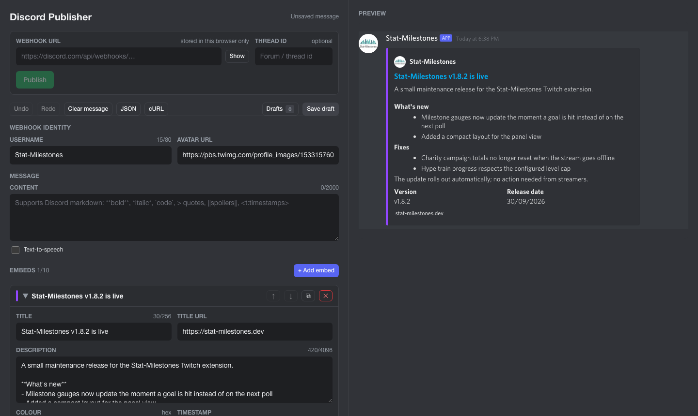

# Discord Publisher

**Compose, preview, publish and track Discord webhook messages, together with your team.**

Build the message in a form, see exactly how Discord will render it, send it with one click, and come back later to edit or delete what you sent. Use it straight away as a guest, with everything saved in your browser. Or sign in with your email (no password), create an organization, invite your team, and share webhooks, servers, authors and drafts between everyone in it.

Built with Vue 3, Vite, TypeScript and Firebase (Authentication and Firestore). Runtime dependencies: `vue`, `firebase`, `zod`, `simple-markdown` and `highlight.js`.

Live site: **https://jackmcguire1.github.io/discord-publisher-vue/**



## Contents

- [Features](#features)
- [Quick start](#quick-start)
- [How to use it](#how-to-use-it)
- [Organizations and roles](#organizations-and-roles)
- [Discord limits enforced](#discord-limits-enforced)
- [Testing and CI](#testing-and-ci)
- [Deploying](#deploying)
- [Firebase setup](#firebase-setup)
- [Data and privacy](#data-and-privacy)
- [How publishing works](#how-publishing-works)
- [Project structure](#project-structure)
- [Troubleshooting](#troubleshooting)

## Features

### Accounts and organizations

- **Guest mode**: no account needed. Webhooks, servers, authors and drafts are saved in this browser only.
- **Passwordless sign-in**: enter your email, click the link you receive.
- **Organizations** hold everything shared: webhooks, servers, authors and drafts. Belong to several and switch between them from the header.
- **Invite by email**: admins invite an address as member or admin; that person joins the next time they sign in.
- **Navigation bar** with an account menu, and a **Settings** page for the organization, members and invites, webhooks and servers, authors and your account. Guests get the webhooks and authors sections.
- **Roles**: owners and admins manage webhooks, servers and membership; members use them and work on authors and drafts.
- **Bring your guest data**: after signing in, webhooks, authors, servers and drafts saved as a guest can be imported into an organization in one click.

### Editing

- Webhook identity: custom **username** and **avatar URL** per message.
- **Reusable authors**: save a name, link and avatar once, then apply it in one click as the webhook identity or as any embed's author block. Save the values already typed into either place with "Save as author".
- **Content** with full Discord markdown and a text-to-speech toggle.
- Up to **10 embeds**, each with title, URL, description, colour, timestamp, author (name, URL, icon), image, thumbnail, footer (text, icon) and up to **25 fields** with inline layout.
- Reorder, duplicate and delete embeds and fields. Collapse embeds you are not working on.
- **Undo and redo** with Ctrl/Cmd+Z and Ctrl/Cmd+Shift+Z.
- Inline **validation** against Discord's limits with live character counters. Publishing is blocked until the message is valid.

### Preview

- Renders the message as Discord does, using Discord's fonts and styling.
- Markdown support: bold, italic, underline, strikethrough, inline code, fenced code blocks with syntax highlighting, block quotes, headings, subtext, lists, spoilers, links, user/role/channel mentions, `@everyone`/`@here`, custom emoji and `<t:…>` timestamps in every format.
- Inline fields lay out in rows of three, just like Discord.

### Publishing

- **Saved webhooks**: give each webhook URL a nickname and description, then pick the destination from a dropdown. Add, edit and delete them from the Manage dialog, or save a URL you have just typed with one click.
- **Servers**: group webhooks by Discord server (or organisation). The dropdown groups by server, drafts are filed under the server they were published to, and an optional Discord server ID makes "open in Discord" links point at the right place.
- Or paste a webhook URL directly. Saved webhooks are shared with your organization; a pasted URL stays in your browser. Either way it is masked in the UI.
- Optional **thread ID** for posting into forum posts or threads.
- **Publish** sends the message and records the returned message ID.
- **Update published** edits the message in place on Discord.
- **Delete from Discord** removes it.
- Each published message links straight to it in Discord and shows which saved webhook it went through.

### Export and import

- **JSON**: view the exact payload that will be sent, copy it, download it, paste a payload from anywhere, or import a file, then apply it back to the editor. Hex colour strings and `null` fields from other tools are handled.
- **cURL**: a ready-to-run command for sending or editing, copyable or downloadable as a shell script.

### Messages: drafts and sent history

- **Messages** in the navigation bar (or the toolbar, as a quick dialog) lists drafts, published messages and messages deleted from Discord, with filters for each.
- Every publish is recorded with who published it, when, through which webhook, and who last updated it. Deleting from Discord keeps the message as history (marked deleted) instead of losing it; publishing it again creates a new message.
- **Load** on a published message selects the webhook it went through and pulls its current content from Discord, ready to update or delete.
- **+ New message** (editor header, Messages page) starts a blank message, keeping your webhook identity and selected webhook. If the editor has unsaved changes it asks first: save as a draft, discard, or cancel. The header shows the message you're editing and whether it has unsaved changes.
- **Versions**: every save, publish and Discord update is kept as a numbered revision (v1, v2, …) with who made it and when. **History** (in the Messages list, or the `vN · History` button in the editor header) lists them with a preview of each; **Restore** opens an old version in the editor as unsaved changes, so saving or updating records it as a new revision and nothing is lost. Duplicates start their own history.
- Save, rename, duplicate, delete, export and import drafts.
- Publishing automatically creates a draft if you have not saved one, so every send is tracked.
- Drafts record when they were last updated and when and where they were published.
- Drafts are grouped by server. A published draft is filed under its webhook's server automatically; you can move any draft between servers from the list.
- Drafts are shared with your organization, so anyone in it can pick one up, edit it and update the published message.
- Export one draft or all of them as JSON and import them into another organization.

## Quick start

Requires Node 24.12 or newer, Yarn 1, and Java 21 or newer for the Firebase emulators. With [mise](https://mise.jdx.dev), `mise install` sets up Node and Java from `mise.toml`.

```bash
git clone https://github.com/jackmcguire1/discord-publisher-vue.git
cd discord-publisher-vue
yarn install
yarn emulators   # terminal 1: local Firebase Auth + Firestore
yarn dev         # terminal 2
```

Open http://localhost:5173. You start as a guest; click **Sign in** and use any email address. In development nothing is emailed: the sign-in link is printed in the `yarn emulators` output. The Emulator UI at http://localhost:4000 shows users and Firestore data.

Development never touches the real Firebase project. `.env.development` points the app at the emulators under the `demo-discord-publisher` project id. Emulator data is saved to `.emulator-data/` when you stop the emulators with Ctrl+C and loaded again next time; delete that folder to start fresh.

| Command             | What it does                                                    |
| ------------------- | --------------------------------------------------------------- |
| `yarn emulators`    | Start the Auth and Firestore emulators (UI on port 4000)        |
| `yarn dev`          | Start the dev server with hot reload, against the emulators     |
| `yarn typecheck`    | Run `vue-tsc` across the project                                |
| `yarn build`        | Type-check, then build to `dist/` with the production config    |
| `yarn preview`      | Serve the production build locally                              |
| `yarn test`         | Start the emulators and run the Cypress e2e suite headlessly    |
| `yarn test:open`    | Open the Cypress runner (start `yarn emulators` first)          |
| `yarn test:rules`   | Run the Firestore security rules tests                          |
| `yarn deploy:rules` | Deploy Firestore rules and indexes to production                |

## How to use it

### 1. Use it as a guest, or sign in

As a guest everything below works, and it is saved in this browser only. To share with a team, click **Sign in**, enter your email and click the link that arrives. If someone has invited you, accept the invitation; otherwise create an organization. Signed in, everything below is shared with the organization you are in, shown at the top left. Anything you saved as a guest can be imported from the banner that appears.

### 2. Get a webhook URL

In Discord, open the channel settings, go to **Integrations → Webhooks**, create one and copy its URL. It looks like `https://discord.com/api/webhooks/<id>/<token>`. Treat the token like a password: anyone with the URL can post to that channel.

Guests and organization admins add webhooks: in the editor, click **Manage** next to the Webhook dropdown, give the webhook a nickname (for example "Announcements") and an optional description, and paste the URL. It is selected automatically. Add as many as you like and switch between them from the dropdown. If you would rather not save it, choose **Custom URL** and paste it into the **Webhook URL** box; a **Save…** button appears if you change your mind.

If you publish to more than one Discord server, add each one under **Servers** in the same dialog and assign webhooks to it. The dropdown then groups webhooks by server, and drafts are filed under the server they were published to. Adding the Discord server ID (Server Settings → Widget, or right-click the server with developer mode on) is optional but makes the "open in Discord" links resolve directly.

### 3. Build the message

If you post as the same brand each time, open **Authors** in the toolbar and save its name, link and avatar. The author dropdown above the webhook identity fields fills in username and avatar; the one in each embed's Author section fills in name, link and icon. The list shows each author's avatar, and the dropdown keeps showing which author is in use for as long as the fields still match it. Both places also offer **Save as author…** once you have typed something.

Fill in the content and add embeds. The preview on the right updates as you type. Red text under a field means Discord would reject the message; the publish button stays disabled until everything is fixed.

### 4. Publish

Click **Publish**. On success you get a toast with the message ID, a green banner with a link to the message, and a draft is created automatically if you did not already have one.

### 5. Edit or delete later

Load the draft (or just stay on it), make your changes, and click **Update published**. Discord edits the original message in place. **Delete from Discord** removes it and clears the published state on the draft. Both actions require the same webhook that originally sent the message; if a different webhook is configured the buttons are disabled and the banner tells you why.

### 6. Save and move drafts around

**Save draft** stores the current message under a name, shared with your organization. **Messages** opens the list of drafts, published and deleted messages, where you can load, rename, duplicate, export or delete them. Loading a published message pulls its current content from Discord so you can update or delete it. **Export all** produces a single JSON file you can **Import** into another organization.

### Tips

- **Timestamps**: use the date picker, or click **Now**. In content, `<t:1700000000:R>` renders as relative time.
- **Colours**: use the picker or type a hex value. Clear it for Discord's default grey bar.
- **Images**: embed images and thumbnails need a direct, publicly reachable URL.
- **Keyboard**: Esc closes any modal. Undo/redo shortcuts work when focus is not inside a text field, so native text undo keeps working too.

## Organizations and roles

**Settings → Organizations** lists every organization you belong to and any invitations waiting for you. Switch between them there or from the selector next to your avatar, create a new one (you're switched into it), rename the current one, leave it, or, as an admin, delete it. Deleting removes the organization and all its webhooks, servers, authors, drafts, members and invites for everyone; you confirm by typing its name. Messages already posted on Discord are not touched. **Settings → Members** handles members, roles and invites. The owner can **Make owner** on any member to hand the organization over: that member becomes the owner and the previous owner becomes an admin (who can then leave if they want).

| Role   | Can do                                                                                     |
| ------ | ------------------------------------------------------------------------------------------ |
| Owner  | Everything an admin can, plus handing ownership to someone else. There is exactly one; the owner can't be removed or leave without first transferring ownership. |
| Admin  | Add, edit and delete webhooks and servers. Invite and remove people, change member roles. Delete the organization. |
| Member | Add and edit authors and drafts, and leave the organization. Plus, per member: **Publish & edit** (publish and update messages on Discord, on by default) and **Delete** (delete messages from Discord and remove published ones from the history, off by default). |

Invites are addressed to an email and are **not emailed**. The invitee sees the invitation when they sign in with exactly that address (a `+tag` counts: `you+a@gmail.com` and `you+b@gmail.com` are different), and joins with the invited role. Use **Copy invite link** next to a pending invite and send it to them yourself: it opens sign-in with their address filled in. Admins can revoke an invite that hasn't been accepted.

Admins set a member's permissions in **Settings → Members**, or when inviting them. These permissions are enforced by the Firestore security rules (`firebase/firestore.rules`) for the organization's records, not just hidden in the UI. Because the browser calls Discord directly and members can read webhook URLs, a determined member could still call Discord themselves; fully enforcing publish/delete would need server-side code (Cloud Functions).

## Discord limits enforced

| Element                        | Limit        |
| ------------------------------ | ------------ |
| Content                        | 2000 chars   |
| Username                       | 80 chars     |
| Embeds per message             | 10           |
| Embed title                    | 256 chars    |
| Embed description              | 4096 chars   |
| Fields per embed               | 25           |
| Field name                     | 256 chars    |
| Field value                    | 1024 chars   |
| Footer text                    | 2048 chars   |
| Author name                    | 256 chars    |
| Total text across one embed    | 6000 chars   |

Discord also rejects usernames containing "clyde" or "discord", and the names "everyone" and "here". The validator catches those too.

## Testing and CI

End-to-end coverage lives in `cypress/e2e/` and runs against the dev server on port 5180 and the Firebase emulators. `yarn test` starts the emulators itself. Each test wipes the emulators, signs in through the real email-link flow (reading the link from the auth emulator) and creates a fresh organization. The suite stubs Discord's webhook endpoints with `cy.intercept`, so no real request leaves the machine and no webhook is needed. It covers:

- guest mode: using the editor signed out, local persistence, opening sign-in, importing guest data into an org after signing in
- sign-in and organizations: creating an org, staying signed in, inviting a teammate who joins as a member, member restrictions, importing pre-sign-in browser data

- editor behaviour: starter message, markdown rendering, adding/removing embeds and fields, limits and counters, undo/redo, clear, persistence across reloads
- saved webhooks: add, edit, delete, select, auto-select on save, save a typed URL, persistence
- authors: add, edit, delete, apply as webhook identity, apply to an embed, prefilled save from either place, validation, persistence
- servers: grouping in the dialog and dropdown, auto-filing published drafts, moving drafts, deleting a server, Discord links, export/import round-trip
- publishing: URL validation, `POST …?wait=true` payload shape, thread IDs, `PATCH` edits without identity fields, `DELETE`, webhook mismatch handling, Discord error surfacing
- JSON and cURL export, pasting and applying JSON, invalid JSON handling
- drafts: save, update, save-as-new, load, rename, duplicate, delete, published state, import of export files and bare payloads

```bash
yarn test         # headless, about 90 seconds
yarn test:open    # interactive (start `yarn emulators` first)
yarn test:rules   # Firestore security rules
```

The rules tests (`tests/rules/`, Node's built-in test runner with `@firebase/rules-unit-testing`) check that outsiders can't read anything, members can't change webhooks or roles, invites can't be used by the wrong or an unverified email, and nobody can take over an org.

Three GitHub Actions workflows keep the repo healthy:

| Workflow                    | Trigger                | What it does                                                                 |
| --------------------------- | ---------------------- | ---------------------------------------------------------------------------- |
| `ci.yml`                    | PRs and pushes to main | Type-check, production build, rules tests, Cypress against the emulators. Uploads screenshots on failure. |
| `dependabot-automerge.yml`  | Dependabot PRs         | Enables auto-merge for minor and patch bumps once CI passes. Comments on majors. |
| `deploy.yml`                | Pushes to main         | Builds and publishes to GitHub Pages.                                        |

Dependabot (`.github/dependabot.yml`) opens one grouped PR a week for minor and patch npm updates, separate PRs for major versions, and a grouped PR for GitHub Actions.

For auto-merge to work the repository needs two settings, both one-time:

1. **Settings → General → Pull Requests**: tick **Allow auto-merge**.
2. **Settings → Branches**: add a protection rule for `main` that requires the **Typecheck, build and e2e** status check. Without a required check, auto-merge would merge immediately rather than waiting for CI.

Merges triggered with the default `GITHUB_TOKEN` do not start other workflows, so an auto-merged Dependabot PR would not redeploy the site. To fix that, create a fine-grained personal access token with `contents: write` and `pull_requests: write` on this repo and add it as the `AUTOMERGE_TOKEN` secret. The workflow uses it when present and falls back to `GITHUB_TOKEN` otherwise.

## Deploying

The repo ships a GitHub Actions workflow (`.github/workflows/deploy.yml`) that builds and deploys to GitHub Pages on every push to `main`.

One-time setup: in the repository on GitHub go to **Settings → Pages** and set **Source** to **GitHub Actions**. Push to `main` and the site appears at `https://<user>.github.io/<repo>/` after about a minute.

The production base path defaults to `/discord-publisher-vue/`. If your repository has a different name, or you use a custom domain, set `VITE_BASE`:

```bash
VITE_BASE=/ yarn build            # custom domain or user site
VITE_BASE=/my-repo/ yarn build    # different repo name
```

The built site is static (Firebase is called from the browser), so it also works from any static host: Netlify, Vercel, Cloudflare Pages, an S3 bucket. Add the host's domain to Firebase's authorized domains (below) or sign-in links will be rejected.

## Firebase setup

Production uses the Firebase project `discord-publisher-8a732`. Its web config is in `.env` and is committed on purpose: it identifies the project but grants no access, and it ends up in the built JavaScript anyway. Access is controlled by the security rules. Service-account keys or deploy tokens must never be committed.

Only Authentication and Firestore are used; Firebase Storage and Cloud Functions are not. The project is on the Blaze (pay-as-you-go) plan, which allows 25,000 email-link sign-in emails a day; on the free Spark plan the limit is 5 a day for the whole project. Usage at this scale stays within the free allowance, but set a budget alert in Google Cloud Console → Billing since Blaze has no spending cap.

One-time setup in the [Firebase console](https://console.firebase.google.com/project/discord-publisher-8a732):

1. **Authentication → Sign-in method**: enable **Email/Password** and switch on **Email link (passwordless sign-in)**.
2. **Authentication → Settings → Authorized domains**: add every domain the site is served from, e.g. `jackmcguire1.github.io`.
3. **Firestore Database**: create the `(default)` database. Don't create any collections by hand; the app creates them.
4. Deploy the rules and indexes: `npx firebase login`, then `yarn deploy:rules`. Or paste `firebase/firestore.rules` into Firestore → Rules and add the two single-field exemptions from `firebase/firestore.indexes.json` (`members.uid` and `invites.email`, ascending, collection group scope) under Firestore → Indexes. Keep the files in the repo as the source of truth.
5. Optional: in Google Cloud Console → APIs & Services → Credentials, restrict the "Browser key" to your site's domains.

Firestore layout:

```
orgs/{orgId}                  name, ownerUid
├─ members/{uid}              uid, email, role (owner | admin | member)
├─ invites/{email}            email, role, orgName, invitedBy
├─ webhooks/{id}              name, description, url, serverId
├─ servers/{id}               name, guildId
├─ authors/{id}               name, url, avatarUrl
└─ drafts/{id}                name, message, serverId, published, deleted, revision
   └─ revisions/{id}          number, kind (saved | published | updated), message, createdAt, createdBy
```

## Data and privacy

As a **guest**, nothing leaves your browser except messages sent to Discord: webhooks, servers, authors and drafts live in `localStorage`. Clearing site data removes them, so export drafts you want to keep.

When **signed in**, shared data (webhooks, servers, authors, drafts) is stored in Firestore under your organization, readable only by its members. Firestore encrypts it at rest.

Webhook URLs contain a secret token. **Every member of an organization can read the full URLs of its saved webhooks**, because their browser sends messages to Discord directly. Only invite people you would trust with the webhooks themselves. Drafts record the webhook **ID** and the published message ID, never the token, so exported draft files are safe to share. The cURL export includes the full webhook URL, so treat that output as sensitive.

Signed in, a few things still stay in this browser's `localStorage`, under the `discord-publisher:` prefix:

| Key        | Contents                                                          |
| ---------- | ----------------------------------------------------------------- |
| `current`  | The message currently in the editor and which draft it came from  |
| `settings` | Active webhook URL, which saved webhook it came from, thread ID   |
| `org`      | Which organization you last worked in                             |

Your sign-in session is also kept in `localStorage` by Firebase. Guest data lives under `drafts`, `webhooks`, `servers` and `authors`; after signing in, the app offers to import it into your organization (Settings → Organization) and removes it from the browser afterwards.

Messages go only to the Discord webhook you choose. Firebase receives your email address and your organization's data.

## How publishing works

The app talks to Discord's webhook endpoints directly from the browser. Discord allows cross-origin requests to these endpoints, which is why no server-side code is needed.

| Action  | Request                                                                 |
| ------- | ----------------------------------------------------------------------- |
| Publish | `POST /webhooks/{id}/{token}?wait=true` (and `thread_id` if set)        |
| Update  | `PATCH /webhooks/{id}/{token}/messages/{messageId}`                     |
| Delete  | `DELETE /webhooks/{id}/{token}/messages/{messageId}`                    |

`wait=true` makes Discord return the created message so its ID can be recorded. On `PATCH`, Discord ignores `username`, `avatar_url` and `tts`, so they are left out of edit payloads, and `content` plus `embeds` are always sent explicitly so that clearing them in the editor clears them on Discord too.

Before sending, the payload is cleaned: editor-only `id` fields are removed and empty strings, empty objects and empty arrays are dropped. The **JSON** modal shows the result of that cleaning, so what you see there is byte-for-byte what Discord receives.

## Project structure

```
src/
├─ discord/
│  ├─ schema.ts        Zod schema, limits, validation, payload normalisation
│  ├─ webhook.ts       URL parsing, payload building, send/edit/delete, cURL
│  └─ markdown.js      Discord markdown → HTML for the preview
├─ firebase.ts        Firebase init; connects to the emulators in development
├─ stores/
│  ├─ session.ts       Sign-in, memberships, invites, active organization
│  ├─ org.ts           Members and invites of the active org, admin actions
│  ├─ orgCollection.ts Shared collection as a reactive array: Firestore when signed in, localStorage for guests
│  ├─ legacy.ts        Import of guest localStorage data after sign-in
│  ├─ message.ts       Current message, validation, undo/redo
│  ├─ drafts.ts        Saved drafts and import/export
│  ├─ settings.ts      Active webhook URL and thread ID
│  ├─ webhooks.ts      Saved webhooks (nickname, description, URL, server)
│  ├─ servers.ts       Servers that group webhooks and drafts
│  ├─ authors.ts       Reusable authors (name, URL, avatar) and the dialog state
│  ├─ toasts.ts        Notifications
│  └─ persist.ts       localStorage helpers
├─ components/
│  ├─ MessageEditor.vue, EmbedEditor.vue, EmbedFieldEditor.vue
│  ├─ MessagePreview.vue
│  ├─ NavBar.vue, MessagesPage.vue, SettingsPage.vue, SignIn.vue, OrgSetup.vue
│  ├─ MessagesPanel.vue, MessagesModal.vue
│  ├─ OrgGeneralPanel.vue, MembersPanel.vue, AccountPanel.vue, WebhooksPanel.vue, AuthorsPanel.vue
│  ├─ PublishPanel.vue, Toolbar.vue
│  ├─ JsonModal.vue, CurlModal.vue, WebhooksModal.vue, AuthorsModal.vue
│  ├─ AuthorPicker.vue
│  └─ Field.vue, Modal.vue, Toasts.vue
├─ styles/
│  ├─ app.css          Application styling (CSS variables, dark theme)
│  └─ preview.css      Discord message styling for the preview
├─ router.ts          Hash routes for the editor, messages and settings pages
├─ App.vue
└─ main.ts
firebase/
├─ firestore.rules       Security rules: who can read and write what
└─ firestore.indexes.json
tests/rules/             Security rules tests
cypress/
├─ e2e/              guest, org, settings, editor, publish, webhooks, servers, authors, export-import and drafts specs
└─ support/e2e.ts    custom commands (visitClean, visitGuest, signIn, createOrg, stubDiscord, …)
```

There is no router, no Pinia and no UI framework. Stores are plain module-level `ref`s; the shared ones are kept in sync with Firestore by live listeners.

## Troubleshooting

**The sign-in link says the domain is not authorized (`auth/unauthorized-continue-uri`)**
Add the site's domain under Authentication → Settings → Authorized domains in the Firebase console.

**The sign-in link opens but asks for my email again**
You opened it in a different browser from the one you requested it in. Enter the same email address and sign-in completes.

**An invited person sees "Create an organization" instead of the invite**
They signed in with a different address from the one invited; the welcome screen shows which one. Send them the invite link, or revoke and re-invite the address they used.

**Sign-in emails stop arriving (`auth/quota-exceeded`)**
Firebase limits email-link sign-in emails per project: 25,000 a day on Blaze, only 5 on the free Spark plan. Check which plan the project is on, and wait until the next day if the limit was hit.

**"Missing or insufficient permissions" (`permission-denied`)**
The Firestore rules in the console don't match `firebase/firestore.rules`; deploy them again. As a member, you also can't change webhooks or servers; ask an admin.

**`failed-precondition` / "requires an index" after signing in**
The `members.uid` or `invites.email` index exemption is missing or still building. Run `yarn deploy:rules`, or follow the link in the error.

**The emulators don't start**
They need Java 21 or newer (`java -version`). `mise install` provides it.

**"Not a Discord webhook URL"**
The URL must match `https://discord.com/api/webhooks/<id>/<token>`. `discordapp.com`, `ptb.` and `canary.` hosts are accepted too. Query strings are stripped automatically.

**Publish fails with HTTP 400**
Discord rejected the payload. The toast includes Discord's error detail. Common causes are an image URL that is not publicly reachable, or a URL field that is not a real URL. The validator catches most of these before sending.

**Publish fails with HTTP 401 or 404**
The webhook was deleted in Discord, or the token is wrong. Create a new webhook and paste the new URL.

**Update or Delete buttons are disabled**
The configured webhook does not match the one that published the message. Switch back to the original webhook URL. Only the webhook that created a message can edit or delete it.

**Images show in the preview but not on Discord**
The preview loads images from your browser, which may have cookies or network access that Discord's servers do not. Use a direct, public image URL.

**My drafts and webhooks are missing**
Signed in, check the organization selector in the header: they belong to one organization. Guest data is per browser; if you saved things as a guest, sign in from that same browser and import them.
